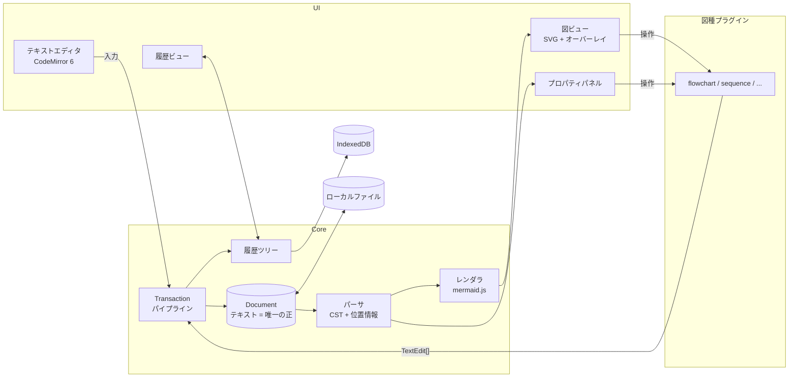
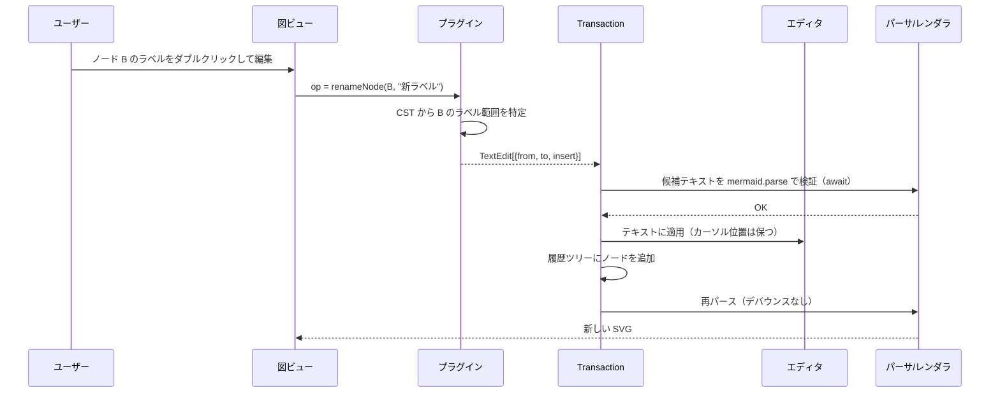

# Mermaid Studio Web 設計書

- 版: 0.2（実装に合わせて改めた版）
- 日付: 2026-11-01（初版ドラフト: 2026-10-24）
- 入力: `request.txt`、およびヒアリング（2 回）
- 初版から実装で変えたところは、該当する節に「実装では」として書き足し、§12.1・§16〜§18 に経緯を残す

---

## 0. 要求と対応箇所

| # | 要求（request.txt） | 対応する設計 |
|---|---|---|
| R1 | 完全にブラウザ上だけで動作すること | §2 アーキテクチャ、§9 保存・入出力、§11 非機能 |
| R2 | mermaid テキストをグラフィカルに表示できること | §5 レンダリング |
| R3 | 図を直接編集できる。図の編集がリアルタイムにテキストへ反映される | §3 中核方針、§4 パーサ、§6 図の編集、§7 プラグイン |
| R4 | 無限に undo できる。history を表示できる | §8 履歴 |

### ヒアリングで決まったこと

| 論点 | 決定 |
|---|---|
| 図の直接編集に対応する図種 | **全図種**（プラグイン方式で段階的に実装） |
| ノードのドラッグ配置 | **構造の編集のみ**。位置は常に Mermaid の自動レイアウト。テキストは純粋な Mermaid のまま保つ（座標そのものが Mermaid の書き方である図種だけは、その座標を書く。§6.3） |
| 同期の向き | **双方向で、書式を保つ**。図からの変更は該当箇所だけ差分で書き換え、コメント・インデント・空行を壊さない |
| 履歴 | **ツリー型で、永続化する**。undo 後に別の編集をしても元の分岐は残る。リロード後も undo できる |
| 実装順 | 利用頻度順（§12） |
| 技術スタック | Vite + React + TypeScript |
| 保存・入出力 | 複数図の管理、ローカルファイルの読み書き、画像エクスポート、URL 共有のすべて |

---

## 1. スコープ

### 対象
- Mermaid の全図種の表示
- 全図種の「図からの編集」（図種ごとに編集手段は異なる。§7.3）
- テキストと図の双方向リアルタイム同期
- ツリー型の無制限 undo/redo と履歴ビュー
- 複数の図の管理、ローカルファイルの読み書き、SVG/PNG 出力、URL 共有
- オフラインでの動作（PWA）

### 対象外
- サーバー、アカウント、クラウド同期、リアルタイムの共同編集
- ノードの自由配置（座標の保存）
- Mermaid 構文の拡張（独自の構文は作らない）

---

## 2. アーキテクチャ概要

静的ファイルのみで構成する SPA。どの静的ホスティングにも置ける（GitHub Pages、Cloudflare Pages など）。ネットワーク通信は初回の読み込みだけで、図の内容は一切外部に送らない。



### 主要なライブラリ

| 用途 | ライブラリ |
|---|---|
| UI | React 19 + TypeScript、状態管理は Zustand |
| テキストエディタ | CodeMirror 6（**標準の history 拡張は使わない**。§8）。警告の波線は `@codemirror/lint`（§17.5）、vi のキーバインドは `@replit/codemirror-vim`（§16） |
| 描画 | mermaid（**バージョンを固定**する。§5.3） |
| パーサ | 図種ごとに自前実装（行単位の手書き。§4.2 の「実装では」）。妥当性は `mermaid.parse` で判定する |
| 保存 | IndexedDB（`idb` ラッパー） |
| 圧縮 | `fflate`（URL 共有と履歴スナップショット） |
| PWA | `vite-plugin-pwa`（Workbox） |
| GIF の符号化 | 自前（`src/io/gif.ts`。§17.8） |
| テスト | Vitest（jsdom・React Testing Library・fast-check・fake-indexeddb）、Playwright |

---

## 3. 中核方針：テキストを唯一の正とする

**図のモデルは別に持たない。Mermaid テキストを唯一の正（Single Source of Truth）とする。**

- テキスト入力も図からの操作も、最終的にはすべて **`TextEdit[]`（ソースの範囲置換）** になる。
- `TextEdit[]` は単一の Transaction パイプラインを通る。適用 → 履歴に記録 → 再パース → 再描画。
- 図からの操作は「テキストのどこをどう書き換えるか」を計算するだけ。図側に状態を持たないので、同期のずれは起きない。

```ts
// 実体は CodeMirror の ChangeSet を使う（invert / compose / toJSON・fromJSON が揃っており、
// 逆操作と IndexedDB への保存をそのまま賄える）。オフセットは「編集前の文書」基準、昇順、重なりなし。
interface TextEdit { from: number; to: number; insert: string }

interface Transaction {
  edits: TextEdit[];
  origin: 'typing' | 'diagram-op' | 'paste' | 'file-load' | 'restore';
  label: string;            // 履歴ビューに出す説明（例:「ノード B を追加」）
  selectionAfter?: Selection;
}
```

実装では、`TextEdit[]` に当たるのは CodeMirror の `ChangeSpec` / `ChangeSet`、`Transaction` に当たるのは `applyChanges(changes, meta)`（`src/core/editing.ts`。`meta` は `origin`・`label`・`groupKey`・`selBefore` / `selAfter`）。`origin` には起動時の最初のノードを表す `'init'` が加わった。図からの操作は `applyDiagramChange()` で `mermaid.parse` による検証をしてから `applyChanges()` に渡す。

この方針により、R3（双方向・書式保持）と R4（統一された無制限 undo）が矛盾なく両立する。2 つのモデルを双方向に同期させる方式では、書式保持・undo の単一化・リアルタイム性が互いに衝突するため採用しない。

### 同期の流れ



---

## 4. パーサ（位置情報つき CST）

### 4.1 なぜ自前のパーサが必要か
mermaid.js の内部のパース結果（diagram db）は、ソース上の位置・コメント・空行を捨ててしまう。そのため「該当箇所だけ書き換える」ことができない。

### 4.2 方針
- 図種ごとに **ロスレスな CST（具象構文木）** を作るパーサを用意する。
  - すべてのノードが `from/to` オフセットを持つ
  - コメント（`%%`）、空行、インデントはトリビアとして保持する
  - `print(parse(text)) === text`（バイト単位で一致）を保証する
- **妥当性の最終判定は `mermaid.parse()` に任せる**。自前のパーサは「位置を特定する」ことに専念し、厳密さは Mermaid 本体に任せる。
- `@mermaid-js/parser`（Langium 製）がカバーする図種（固定するバージョン時点で、pie、gitGraph、info、packet、architecture、radar、treemap など。実装着手時に確認する）は、その AST の位置情報を使う。
- jison 製の図種（flowchart、sequence、class、state、ER、gantt など）は自前で実装する。CodeMirror のハイライトと共用できる **Lezer 文法** を第一候補とする。
- **実装では**、CST も Lezer 文法も `@mermaid-js/parser` も使わず、図種ごとに **行単位で読む手書きのパーサ**にした（`src/plugins/source.ts`・`lineOps.ts`。railroad だけは mermaid の字句の正規表現に合わせた小さな字句解析）。図からの操作に要るのは「どの要素がどの範囲か」だけで、テキストの全体を木に起こさなくても、範囲を書き換えれば書式は保てるため。読めない行は飛ばし、その行は図から編集しない（テキストで編集する）。エディタのハイライトは `StreamLanguage`（`src/render/mermaidLanguage.ts`）。

### 4.3 パースできないテキストの扱い
入力中は一時的に文法が壊れることが多い。

| 状態 | 図ビュー | 図からの操作 | 表示 |
|---|---|---|---|
| 正常 | 最新の描画 | 可能 | — |
| 構文エラー | **最後に正常だった描画を薄く表示** | **不可**（読み取り専用） | エディタにエラー位置のマーカー、図の上部にエラーバナー |
| 未対応の図種 | 描画のみ | 不可 | 「この図種は表示のみ」と表示 |

- 再パースは入力ごとに行う。重い図に備えて、描画は 150ms のデバウンス、パースはデバウンスなしにする。
  - 実装で改めた: 描く前に別に検証せず、`mermaid.render` の構文解析を検証として使う。待ちは、描いている間に入力があったときだけ、描き終えてから 150ms 空ける（§17.1・§18.3）。
- パースと描画は Web Worker に逃がすことを検討する（mermaid は DOM を必要とするため、描画はメインスレッド）。`mermaid.parse` は flowchart などで DOMPurify を使うため **DOM なしでは動かない**ことを確認した（2026-10-24、mermaid 12.2.0）。Worker で検証するには DOM の代替が必要。自前の CST パーサは DOM 非依存なので Worker に移せる。測った結果、Worker は使わないことにした（§17.1）。
- **IME 入力中（`compositionstart`〜`compositionend`）は、履歴ノードの作成・再パース・再描画を行わない**。確定時にまとめて処理する。

---

## 5. レンダリング

### 5.1 描画
- `mermaid.render()` で SVG を生成し、図ビューに挿入する。
- 設定: `securityLevel: 'strict'`。`click` コールバックや任意の HTML は無効にする（§9.4 の URL 共有で受け取る内容は信頼できないため）。
- テーマ（default / dark / forest / neutral）は切り替え可能。frontmatter の `config` を優先する。

### 5.2 SVG とソースの対応付け（svgMapper）
図上でクリックした要素が、ソースのどの要素かを特定する必要がある。
- 各プラグインが `svgMapper` を実装し、SVG 要素 → 意味上の ID（例: flowchart のノード ID `B`、エッジの index）を返す。
- 意味上の ID から、CST を介してソース上の範囲を引く。
- 選択状態はこの ID で持ち、テキスト側のカーソル位置と相互にハイライトする（図でノードを選ぶ → エディタの該当行をハイライト、その逆も）。
- 実装では、svgMapper はプラグインの `mapTargets(svg, source)` 1 つにまとめた。描いた SVG とソースから、図の要素ごとに `DiagramTarget`（SVG の要素・ラベルの要素と文字・ソースの範囲・意味上の参照 `ElementRef { kind, id }`）を返す。SVG の要素とソースの要素は、端点などの意味のある値で対応付ける（`src/plugins/svg.ts` の `matchInOrder`）。描画の順番だけに頼るのは、ほかに手がかりが無い state 図の遷移だけ。

### 5.3 バージョン固定
Mermaid が出力する SVG の id/class 体系は図種ごとに異なり、バージョンアップで変わる。
- mermaid の **バージョンを固定**（`package.json` で `~` ではなく完全一致）する。
- svgMapper には図種ごとに回帰テストを用意し、バージョンを上げるときは全テストが通ることを条件にする。

---

## 6. 図の編集

### 6.1 編集 UI の共通部品
| 部品 | 内容 |
|---|---|
| 選択 | クリックで選択、Shift でまとめて選択。選択枠は SVG の上に重ねたオーバーレイ層に描く |
| インライン編集 | ダブルクリックでラベル編集（SVG の上に `<input>` を重ねる）。**1 打鍵ごとに TextEdit を発行してテキストへリアルタイム反映**し、編集セッション全体は履歴上 1 ステップ（「ラベル変更」）にまとめる。再描画のたびに、その要素の位置（実装では `mapTargets` の結果。§5.2）で入力欄の位置を合わせ直す。IME 変換確定の Enter（`event.isComposing`）では編集を終了しない |
| コンテキストメニュー | 右クリックで、その要素に可能な操作を表示 |
| 接続ハンドル | ノードの縁からドラッグして別のノードで離すとエッジを追加（グラフ系の図種） |
| プロパティパネル | 選択した要素の属性（形、矢印の種類、色、class など）をフォームで編集。色の欄は文字で打てる入力欄・見本のボタン・パレット（淡い色と濃い色の 18 色と、ブラウザの色選択の「その他の色」）を組にし、パレットは浮かせず行の中で折り返す（パネルをスクロールしても欠けないように）。形の欄（フローチャート・マインドマップ・ブロック図のノード）は、選択欄では図形を出せないので、今の形を図形で示すボタンと、選択肢の図形を並べた一覧にする（同じく行の中で折り返し、mermaid の形の別名も同じ形として扱う）。1 回選ぶごとに履歴 1 ステップ |
| ツールバー | 図種ごとの「追加」系の操作。ノードを足すボタン（フローチャート・ブロック図）には ▾ を添え、プロパティパネルと同じ図形の一覧から形を選んで足せる（ボタンだけを押せば既定の四角。足した後はそのままラベルを打てる）。図の上に出る「＋ 次のノード」「＋ 間にノード」「＋ 中に追加」など（フローチャート・ブロック図・マインドマップ）も同じ。図の上の一覧は、図の表示から切れないよう下か上の入る方に出す。Tab・右クリックのメニューからは既定の形で足す |
| キーボード | Delete で削除、Enter でラベル編集、Tab で子を追加（mindmap など） |

### 6.2 操作（Op）からテキストへの変換
- 各プラグインは `Op → TextEdit[]` を純粋関数として実装する。
- 書式保持のルール:
  - 新しい行は、近くの兄弟要素のインデントを真似る
  - 削除するときは、その行と、その要素だけに付いたコメントを消す。他は触らない
  - 変更する箇所以外の文字は 1 文字も変えない
- **コミット前に検証する**: op が候補テキストを計算 → `await mermaid.parse(候補)` → 成功したときだけ Transaction をエディタと履歴に確定する。失敗した op は履歴ノードを作らず、トーストで通知する。これはテストでも保証する（§13）。
  - インラインのラベル編集中の 1 打鍵ごとの反映は、検証に失敗した打鍵（例: 未閉じの引用符）では反映を保留し、次の打鍵で再試行する。

### 6.3 位置について
要素のドラッグ移動は、座標を保存せず、**構造の変更**として扱う（`ReorderSpec`、`src/ui/reorderDrop.ts` の `resolveDrop` が落とし先を決める）。動かし方は 3 つ:

| 動かし方 | 内容 | 図種 |
|---|---|---|
| 前後へ（並べ替え） | 要素の前後に落とすと、行（文）の並びを変える。並びの向きは左右（`x`）・上下（`y`）・左上から右下へ読む順（`xy`、格子など） | sequence（参加者・文）、gantt・pie・timeline・journey・gitGraph（コミット）・xychart・sankey・radar・C4・requirement・usecase の行、mindmap・kanban・ishikawa・treeView、block、cynefin、eventmodeling、railroad |
| 中へ（所属の変更） | 枠（サブグラフ・グループ・列など）の中を指して落とすと、その中の最後へ移す。枠の外で落とすと外へ出す。前後にも中にも落とせる要素（mindmap のトピックなど）は、真ん中の半分で中、端で前後 | flowchart・swimlane・agentflow（ノード → サブグラフ・レーン・flow）、architecture（サービス・junction・グループ → グループ）、kanban（カード → 列）、mindmap・ishikawa・treeView（子にする）、treemap、block（入れ子のブロック）、cynefin（項目 → 領域）、venn（項目 → 集合・重なり） |
| 位置へ（座標） | 座標がそのまま Mermaid の書き方である図種だけ、ドラッグした分だけ座標を書き換える | quadrantChart（点の `[x, y]`）、wardley（部品・利用者・メモの `[見える度合い, 進化]`） |

どの動かし方も、書き換えるのは動かす要素の行（と移す先）だけで、`applyDiagramChange` が検証してから適用する。ドラッグは図の要素の位置とソースの範囲が今のテキストと合っているとき（`editable`）だけ始める。
次の図種・要素はドラッグで動かさず、ドラッグは図のパンになる: state・class・ER（枠を持たないグラフで、並びを変えても自動レイアウトの位置は決まらない）、packet の欄（ビットの位置が前から続く）、gitGraph の branch・checkout・merge（後ろの行が頼っている）、関係・線の行、サブグラフの中でエッジの行の一部として書いたフローチャートのノード（その行を枠の外へ移せない）、罫線で書いた treeView。落とせる先が 1 つも無い要素（サブグラフの無いフローチャートのノードなど）も、ドラッグはパンになる。

---

## 7. 図種プラグイン

### 7.1 インターフェース

```ts
interface DiagramPlugin<CST, Id = string> {
  type: string;                         // 'flowchart' | 'sequence' | ...
  detect(text: string): boolean;        // 先頭のキーワードで判定
  parse(text: string): ParseResult<CST>;  // ロスレス、位置情報つき
  capabilities: Capability[];           // 'label' | 'add-node' | 'connect' | 'reorder' | 'props' ...
  svgMapper: {
    hitTest(target: Element): Id | null;
    elementFor(id: Id, svg: SVGSVGElement): Element | null;
  };
  ops: Record<string, (cst: CST, args: any) => TextEdit[]>;
  propertySchema(cst: CST, id: Id): PropertyField[];  // プロパティパネル用
  toolbar?: ToolbarItem[];
}
```

実装では次の形になった（`src/plugins/types.ts`。図種の判定は `mermaid.parse` が返す `diagramType` で行い、`registry.ts` が引く）。パースは各プラグインの中で行い、結果をインターフェースに出さない。どのメソッドもソースを受け取って計算し、図のモデルを持たない（§3）。

```ts
interface DiagramPlugin {
  type: string;                          // mermaid.parse の diagramType。'*' は汎用フォールバック
  mapTargets(svg: SVGSVGElement, source: string): DiagramTarget[];   // §5.2
  actions?: DiagramAction[];             // 追加・削除・接続など。arity 0/1/2、キー（Tab・Delete など）
  inspect?(source: string, ref: ElementRef | null): PropertyField[]; // プロパティパネル（null は図全体）
  setProperty?(source: string, ref: ElementRef | null, fieldId: string, value: string): ChangeSpec | null;
  tables?: TableDef[];                   // 表で編集する部分（§7.3）
  reorder?: ReorderSpec;                 // ドラッグでの移動（§6.3）
  structure?: StructureSpec;             // 親子と線（§17.2）
  duplicate?: DuplicateSpec;             // 複製（§17.3）
}
```

### 7.2 図ビューの汎用フォールバック
視覚編集の op がまだ実装されていない図種には、次の汎用機能を提供する。
- 描画と、テキストとのハイライト連動（svgMapper が無ければ、ラベルの文字列一致で推定）
- **ラベルの文字列のインライン編集**（SVG のテキストとソース中の文字列を一致させて置換。一意に決まらない場合は不可）

これで「全図種で最低限の直接編集ができる」状態を早く作る。

### 7.3 図種ごとの編集手段
「全種類で視覚編集」の中身を図種ごとに定義する。グラフ系の図種はキャンバス上の操作が中心で、データ系の図種はプロパティパネル（表形式）が中心になる。

| 図種 | 主な編集手段 | Phase |
|---|---|---|
| flowchart / graph | ノード追加・削除、接続、ラベル、形、矢印の種類、subgraph への出し入れ、方向（TB/LR）、classDef/style。実装では、サブグラフは g.cluster の id で対応付け、所属は mermaid と同じ「先に閉じたサブグラフが取る」規則で求める。所属の変更は、今のサブグラフの中でノードだけの行で書かれているときに限る（エッジの一部なら変えられない）。エッジを足す・消す操作は linkStyle の番号を付け直す。click・エッジの ID とアニメーション（e1@-->）・読めない行はテキストで編集する | 1 |
| sequenceDiagram | participant の追加と並べ替え（ドラッグ）、メッセージの追加・種類・ラベル、note、loop/alt/opt ブロック、activation。実装では、枠（loop / alt / opt / par / critical / break）は種類と条件で、注釈は本文で SVG と対応付ける。メッセージの上下の移動は同じ区切りの中だけで、枠の出入りは「枠で囲む」「枠を外す」で行う。box への所属、rect の色、単独の activate / deactivate の行、links / properties はテキストで編集する | 2 |
| classDiagram | クラス追加、メンバーの追加と編集、関係（継承・合成など）と多重度 | 2 |
| stateDiagram-v2 | 状態の追加、遷移、複合状態、開始と終了、note | 2 |
| erDiagram | エンティティ、属性（表で編集）、リレーションのカーディナリティ | 2 |
| gantt | タスク表（名前・期間・依存・状態）、セクション、ドラッグで並べ替え | 3 |
| pie | スライスの表（ラベル・値） | 3 |
| mindmap | 子と兄弟の追加（Tab/Enter）、形、並べ替え | 3 |
| gitGraph | commit/branch/checkout/merge の追加、順序 | 3 |
| journey / timeline | セクションとタスク・イベントの表 | 3 |
| quadrantChart / xychart / sankey / radar / treemap | 軸とデータ系列の表、ポイントの値 | 4 |
| requirementDiagram / C4 / block / architecture / packet / kanban | 要素の追加、関係、ラベル、プロパティ | 4 |
| 表で編集する図種（pie・gantt・timeline・journey・gitGraph・quadrantChart・xychart・sankey・packet・radar・treemap・C4・requirementDiagram・usecase） | 図のラベルが表の行の中にあれば、その行を図の要素（kind: row、id: 行番号）として選べる。ラベルの無い要素は意味のある値で行に対応付ける（サンキー図の流れは元と先のノードの色、XY チャートの系列は bar-plot-<番号>、Git グラフのコミットの点は class のコミット ID、要求図は g.node の id と線の data-id、ユースケース図の利用者は data-usecase-id）。プロパティパネルで行の値を変え、図の上のボタンで「次の行」を足す・前後と入れ替える・消す（1 行に複数のラベルがあれば、名前などの文字の欄のラベルを優先して行の要素にする）。次の行は、選んだ行に属する行（section の中・timeline の期間の続き・treemap の子）の後ろに足す。後ろの行が頼っている行（Git グラフの branch・checkout・最初の branch の前のただ 1 つのコミット）と、packet の途中の欄は図から消さない | 5 |
| swimlane / flowchart-elk | フローチャートと同じ（swimlane は最上位の subgraph がレーン） | 5 |
| agentflow | フローチャートのプラグインを、agentflow が描ける形（タスク・ツール・入力・判断・参照資料・操作）と矢印（-->・--x・-.-）に絞って使う。枠は flow で書き、global の行は文として読まない。connector は宣言の行で ID・題名・削除を扱う（線の行だけを変えると、つながりが切れたり、ふつうのノードになったりする） | 5 |
| ishikawa | 頭と要因。中に要因・次の要因を足す、兄弟のあいだで動かす、部分木ごと消す、文言を変える。階層は mermaid と同じく最初の要因からのインデントの差で親を決める。図の要素は描く順番（上側の大骨は子を逆順にたどる）とラベルの一致で対応付ける | 5 |
| treeView | 項目の追加（中・次）・移動・削除、名前、ファイルとフォルダの切り替え、説明（##）・アイコン・クラス。罫線（├──）で書いた木は、名前と注記の変更だけ | 5 |
| venn | 集合・重なり・文字の追加と削除、ラベル・大きさ・塗りの色（style 行）、集合の ID の変更（参照もまとめて変える）。集合を消すと、それを含む重なりも消す（残すと構文エラー）。集合と重なりは data-venn-sets で対応付ける | 5 |
| cynefin | 領域への項目の追加、項目の文言・領域の移動・並べ替え・削除、領域のあいだの遷移の追加・付け替え・ラベル・削除 | 5 |
| wardley | 部品・利用者・メモの追加、依存先の追加（Tab）、線でつなぐ、削除（部品を消すと、その線と evolve の行も消す）、名前・位置・調達の方法・慣性・進化先、線の種類とラベル | 5 |
| eventmodeling | フレームの追加（次のフレームは種類を順に進める）・接続（->>）・移動・削除（他のフレームの ->> からも外す）、名前・種類・tf / rf | 5 |
| railroad（関数・EBNF・ABNF・PEG） | 規則の追加・移動・削除、規則の名前（参照もまとめて変える）と定義、箱（終端・非終端・特別）の文字。書き方ごとに字句の規則を mermaid の文法に合わせて読む | 5 |
| 上記以外・新しい図種 | §7.2 の汎用フォールバック | — |

---

## 8. 履歴（ツリー型・無制限・永続化）

### 8.1 undo の一元化
- CodeMirror の `history()` 拡張は **使わない**。テキスト入力も図の操作も、アプリの履歴ツリーが一元管理する。
- `Ctrl+Z` / `Ctrl+Shift+Z`（`Ctrl+Y`）は、どちらのペインにフォーカスがあっても同じ履歴を辿る。

### 8.2 データ構造

```ts
interface HistoryNode {
  id: string;            // ULID（実装では UUID）
  parentId: string | null;
  children: string[];    // 分岐
  forward: TextEdit[];   // 親 → 自分
  inverse: TextEdit[];   // 自分 → 親
  label: string;         // 「ノード B を追加」「入力: 'hello'」
  origin: Transaction['origin'];
  selectionBefore: Selection;
  selectionAfter: Selection;
  timestamp: number;
  snapshot?: Uint8Array; // N ステップごとの全文（圧縮済み）
}
interface HistoryTree { rootId: string; headId: string; nodes: Map<string, HistoryNode> }
```

実装では（`src/core/history.ts`）、`forward` / `inverse` は CodeMirror の `ChangeSet` の JSON、時刻は `ts`、選択は `selBefore` / `selAfter`。ほかに `docId`・`depth`（根からの深さ）・`lastChild`（redo で進む子）・`groupKey`（§8.3 のまとめの鍵）・`name`（名前付きチェックポイント）を持つ。`snapshot` はメモリでは全文の文字列（無ければ `null`。根は必ず持つ）で、IndexedDB には 512 文字以上なら fflate で圧縮した `snapshotZ` として書く。

- **undo** = head を親へ移す（`inverse` を適用）。
- **redo** = head を子へ移す。子が複数あるときは **最後に訪れた子** を選ぶ（emacs undo-tree と同じ挙動）。
- undo した後に新しい編集をすると、新しい子として分岐が増える。古い分岐は消えない。
- 任意のノードへジャンプ = 共通祖先まで inverse を適用し、そこから forward を適用する。50 ステップ以上離れている場合は、最寄りのスナップショットから復元する。

### 8.3 入力のまとめ方（coalescing）
1 文字ごとに履歴ノードを作らない。次のいずれかで区切る。
- 入力が 1 秒以上止まった
- カーソルが入力位置から離れた
- 単語境界（空白・改行）をまたいだ後に、入力の種類（挿入/削除）が変わった
- 図の操作、貼り付け、ファイル読み込みが起きた（これらは常に独立した 1 ステップ）

vi のキーバインド（§16）でエディタを使うときは、vim の undo の単位に合わせ、時間・カーソル・単語境界では区切らない。
- 挿入モードに入ってから Esc で抜けるまで（`ciw` のように、オペレーターから挿入に入ったときはその削除も含めて）を 1 ステップにする
- ノーマルモードの 1 つのコマンド（`dd`・`p`・`3x`・`.` など）を 1 ステップにする

### 8.4 履歴ビュー
- サイドパネルに **縦方向のツリー（git graph 風）** を表示する。現在の head を強調し、分岐を枝として描く。
- 各ノードには label、時刻、origin のアイコンを表示する。
- ホバーでそのときの図のサムネイルとテキスト差分をプレビューする。クリックでジャンプする。
- 「このバージョンを新しい図として複製」「名前付きチェックポイントにする」を用意する。
- 長い直線区間は折りたたむ。

### 8.5 永続化
- IndexedDB の `history` ストアに、ノードを 1 件ずつ追記する（書き込みは入力が 300ms 止まったときにまとめる。打ち続けていても 1 秒を超えては待たない。§18.3）。
- `documents.text`・`headId` と新しい履歴ノードは **1 つの IndexedDB トランザクションで書く**。書き込み途中でクラッシュしても、テキストと履歴が食い違わない。
- **20 ステップごとにスナップショット**（全文を fflate で圧縮）を保存し、復元とジャンプを高速にする。
- リロード時は head とスナップショットから現在のテキストを復元する。
- **「無制限」の意味**: アプリ側では上限を設けない。ただしブラウザのストレージ容量の制約は受ける。
  - 起動時に `navigator.storage.persist()` で永続ストレージを要求する。
  - `navigator.storage.estimate()` を監視し、使用率が 80% を超えたら警告する。履歴を自動で消すことはせず、ユーザーが「古い分岐を整理」「履歴を書き出してから削除」を選ぶ。
- **複数タブ**: 同じ図を複数のタブで開いたときは、Web Locks API で書き込み権を 1 タブに限定する。他のタブは読み取り専用にし、BroadcastChannel で更新を受け取って追従する。
  - 書き込み権が空いたときの読み直しは、図を開く処理と同じ順番待ち（1 本ずつ）に入れる。後から終わった読み直しが、別の図への切り替えを上書きしないため。
  - 図を切り替えるときは、新しい図を読めてから今の図の書き込み権を手放す（読めなかったときに、書き込み権の無いまま編集できる状態を作らない）。切り替える前に、保存中の書き出しを待つ。
  - 別のタブで消された図を、保存で作り直さない（履歴のルートが無いまま作り直さない）。ゴミ箱にある図はゴミ箱のまま書く（保存で復活させない）。開いている図が別のタブでゴミ箱に入れられたか消されたら、編集中の変更を保存してから閉じる。
  - 保存に失敗したら、ゴミ箱への移動とバックアップの書き出しを止め、図を開いたままにする（ゴミ箱に入れると未保存の変更がメモリから消え、書き出すと未保存の変更が抜けた古い内容を書き出せたと伝えてしまうため）。
  - バックアップを取り込むときは、本文を履歴の head の時点から作り直す（食い違うと、開いて undo したときに変更が本文に合わない）。

---

## 9. 保存・入出力

### 9.1 データモデル（IndexedDB）

| ストア | キー | 内容 |
|---|---|---|
| `documents` | docId（UUID。初版は ULID の予定だった） | title、現在のテキスト、headId、作成と更新の時刻、ゴミ箱に入れた時刻（`deletedAt`）、タグ |
| `history` | [docId, nodeId] | HistoryNode（索引 `byDoc`） |
| `files` | docId | ファイルとの結び付き: `FileSystemFileHandle`（構造化複製で保存可能）、名前、`.mmd` か `.md` か・何番目のブロックか、`lastModified`、最後に保存した本文、`.md` の全文（§9.3） |
| `thumbs` | docId | 図の一覧のサムネイル（最後に描けた SVG） |
| `folders` | id | 開いたフォルダのハンドル（§17.9） |
| `settings` | key | テーマ、レイアウト、キーバインド、部品集など |

保存形式の版は 4（2: `files`、3: `thumbs`、4: `folders` を足した）。版を上げるときは `upgrade` に移行を足し、古いデータを読めなくしない。

履歴は **docId に紐づける**（ファイルハンドルには紐づけない）。ファイルを別名で保存しても履歴は続く。

### 9.2 複数図の管理
- 左サイドバーに図の一覧（サムネイル、タイトル、更新日時、タグ）。検索と並べ替えができる。
- 新規作成（空 / テンプレート）、複製、削除（ゴミ箱で 30 日保持）、名前の変更。

### 9.3 ローカルファイル
- 対応形式: `.mmd`、`.mermaid`、`.md`（`.md` の場合は ```` ```mermaid ```` ブロックを抽出する。複数ある場合は選んで編集し、保存時は該当ブロックだけを差し替える）。
- **Chromium 系**: File System Access API で開く、上書き保存、名前を付けて保存。
  - フォーカスが戻ったときに `lastModified` を確認し、**アプリの外で変更されていたら**「再読み込み / 差分を確認 / 無視」を尋ねる（実装では下の「外部で変更されたとき」の 3 つにした）。再読み込みは履歴上 1 ステップ（origin: `file-load`）になる。
- リロード後に保存済みのファイルハンドルを使うときは `queryPermission` / `requestPermission` が必要。要求はユーザー操作（クリック）の中で行う。
- **Firefox / Safari**: `<input type="file">` で読み込み、ダウンロードで保存するフォールバック。
- ドラッグ＆ドロップでの読み込みにも対応する（バックアップの .json をドロップすると復元）。
- 外部で変更されたとき、図に未保存の変更が無ければ黙って読み込み直す。未保存の変更があればバナーで「読み込む / 上書き保存 / 無視」を選んでもらう（どちらを選んでも今の内容は履歴に残る）。
- **ファイルの関連付け（実装時に追加）**: PWA の manifest の `file_handlers` で `.mmd` / `.mermaid` を受け付け、インストールした Chromium 系で「プログラムから開く」の候補に出す。渡されたファイルは `launchQueue` で受け取り、ハンドルで開く（上書き保存は元のファイルに書く。同じファイルなら前の図を開き、結び付きは OS が渡したハンドルに置き換える）。
  - `launch_handler` は既定のまま（ファイルごとに新しいウィンドウ）にする。`focus-existing` にすると、アイコンから 2 つ目のウィンドウを開けなくなるうえ、普通のタブで開いている図も守れないため。同じ図を開いているウィンドウがあれば、新しいほうは §8.5 の規則で読み取り専用になる。
  - ファイルの受け取りは起動処理より前に始め、起動処理の途中の失敗で止まらないようにする。ファイルを渡されて起動したときは、前回の図や見本の図を開かない。
  - 図を開く処理とファイルを開く処理は 1 本ずつ順に走らせる（続けて開くと書き込み権が漏れ、同じファイルの図が 2 つできるため）。今開いている図を開き直すときは書き込み権を手放さない（Chrome では手放してすぐ取り直すと取れず、読み取り専用になるため）。

### 9.3.1 バックアップ（実装時に追加）
- 図はこのブラウザの IndexedDB にしか無いため、全図を履歴つきで JSON に書き出し、復元できるようにする。
- 復元した図には新しい docId を振る（既存の図を上書きしない）。ファイルとの結び付きは含めない。
- バックアップファイルは信頼できない入力として扱う。履歴がツリーとして正しいか（ルートが 1 つ・循環が無い・親子の対応がそろう・変更が前後の長さに合う）を確かめ、正しくなければ復元しない。循環した履歴を開くと履歴のたどりが終わらず、タブが固まるため。
- 復元では、保存形式にある項目だけを取り出して履歴ノードを作り直す（内部用の項目、たとえば長さを確かめていないスナップショット `snapshotZ` を持ち込ませない）。親子の確認は Set で引き、子の多い細工されたファイルで時間が二乗にならないようにする。

### 9.4 URL 共有
- テキストを `fflate` の deflate で圧縮し、base64url にして **`#` 以降（fragment）** に入れる。fragment はサーバーに送られない。
  - 形式: `https://<host>/#v1/<payload>`（バージョンの接頭辞で将来の形式変更に備える）
- URL が 8,000 文字を超える場合は、長すぎると警告し、ファイルでの共有を勧める。
- 共有 URL を開いたら、**新しい図として IndexedDB に取り込む**（既存の図を上書きしない）。
- **共有された内容は信頼できない入力として扱う**: `securityLevel: 'strict'` を常に使い、frontmatter の `config` でも `securityLevel` の上書きを禁止する。ラベルの消毒では `<style>` に加えてフォームと入力欄（`form`・`input`・`button`・`textarea`・`select`）も落とし、この消毒の設定（`dompurifyConfig`）も図の側から変えられないようにする（パスワード欄などを仕込んだ図で、入力を外部へ送らせないため）。
- 入力のたびに走る処理（入力補完など）は、行の長さに対して線形の時間で終わるようにする。共有リンクに長い 1 行を仕込まれると、二乗の正規表現で画面が固まるため（補完の `@{ shape:` は最後の `@{` から先だけを見て、末尾の語は後ろから 1 文字ずつ取り出す）。
- 展開後の大きさに上限（512KB）を設け、超えたら途中で展開をやめて取り込まない。数百 KB の URL が数百 MB に展開される「展開爆弾」で巨大な図が保存されると、「最後に開いた図」として起動のたびに開かれ、アプリが起動できなくなるため。

### 9.5 画像エクスポート
- **SVG**: 描画済みの SVG を整えて出力する（オーバーレイ層は除く。フォントは埋め込みと参照から選ぶ）。
- **PNG**: SVG → `` → `<canvas>` → `toBlob`。
  - HTML ラベル（foreignObject）を含む SVG は canvas に描くと汚染されたり崩れたりするため、**出力時は `htmlLabels: false` で描画し直す**。それでも foreignObject を使う図種（journey など）は、残った foreignObject を SVG の text に置き換える。
  - 倍率（1x/2x/3x）と背景（透明/白/テーマ色）を選べる。
  - Web フォントは data URI として埋め込んでから描く（実装では未実装。下を参照）。
- **クリップボード**: `navigator.clipboard.write` で PNG と SVG テキストをコピーする。
- 実装では、倍率（1x/2x/3x）と背景（白・透明）を選べる。背景のテーマ色、フォントの埋め込み・参照の選択、Web フォントの data URI での埋め込みは作っていない。

---

## 10. 画面構成

```
┌────────────────────────────────────────────────────────────────┐
│ ☰ ロゴ │ 図のタイトル │ ファイル 編集 表示             │ ⚙      │
├──────┬──────────────────┬───────────────────────────┬──────────┤
│ 図の │ テキストエディタ   │ 図ビュー                   │ 履歴     │
│ 一覧 │ (CodeMirror)     │ [ツールバー]               │ ツリー   │
│      │                  │                           │  ●       │
│ 検索 │ エラーマーカー     │   SVG + 選択オーバーレイ    │  ├●      │
│ タグ │ 選択の連動ハイライト│                           │  │└○     │
│      │                  ├───────────────────────────┤  ●(head) │
│      │                  │ プロパティパネル            │          │
└──────┴──────────────────┴───────────────────────────┴──────────┘
```

- ヘッダーの操作は 3 つのメニューと設定にまとめる。「ファイル」は開く・フォルダを開く・保存・名前を付けて保存・画像の書き出し・共有リンク・バックアップ、「編集」は元に戻す・やり直す、「表示」は一覧と履歴のペイン・全体表示と拡大縮小・プロパティパネル・要素の一覧・発表モード・部品集・タイムラプス・キーの一覧、⚙ は言語・キーバインド・テーマ（と、永続ストレージを得られなかったときの警告）。どれもコマンドパレット（Ctrl+K / Ctrl+Shift+P）からも呼べる。
- 各ペインは幅を変えられ、折りたたみもできる。レイアウトは settings に保存する。
- 図ビューはパンとズーム（ホイール、ピンチ）、全体表示に対応する。
- モバイル幅ではタブで切り替える（テキスト / 図 / 履歴）。
- UI の言語は日本語（既定）と英語。言語は localStorage に持ち、切り替えたら読み込み直す。

---

## 11. 非機能要件

| 項目 | 目標 |
|---|---|
| 完全なクライアント動作 | 外部通信は初回の資産読み込みだけ。PWA でオフラインでも起動と編集が可能。mermaid の図種ごとの遅延読み込みチャンク、アイコンパック（architecture 図）、KaTeX の CSS/フォント（数式）も **すべて同梱してプリキャッシュ** する（CDN 参照はしない） |
| 応答性 | 図の操作から検証後のテキスト反映まで 50ms 以内（うち op 計算は 16ms 以内、残りは `mermaid.parse` の検証）。テキスト入力から再描画（200 ノード規模の flowchart）が 300ms 以内 |
| 起動 | 初回 3 秒以内（mermaid は本体も図種ごとの部分も遅延読み込み。画面とエディタは mermaid を待たずに出し、本体の読み込みは文書の読み込みと並行して始める） |
| 対応ブラウザ | Chrome/Edge 最新 2 版：全機能。Firefox/Safari 最新 2 版：ファイル保存はフォールバック、他は全機能 |
| セキュリティ | `securityLevel: 'strict'`、CSP（本番ビルドの `<meta>` に埋め込む。`default-src 'self'; script-src 'self'; style-src 'self' 'unsafe-inline'; img-src 'self' data: blob:; font-src 'self' data:; connect-src 'self'; object-src 'none'; form-action 'none'; base-uri 'self'`）。`connect-src` で外部への送信を、`form-action` でフォームによる送信（通信ではなく画面の移動なので `connect-src` では止まらない）を塞ぐ。共有された内容は常に信頼しない |
| アクセシビリティ | キーボードだけで主要な操作が可能。図の要素に `aria-label` を付ける |

---

## 12. 段階計画と受け入れ基準

| Phase | 内容 | 受け入れ基準 |
|---|---|---|
| 0 基盤 | エディタ、描画、Transaction、履歴ツリー（直線 UI）、IndexedDB、図の一覧、汎用フォールバック（§7.2） | 全図種が表示できる。リロード後も undo できる。構文エラー時に最後に正常だった描画を保つ |
| 1 flowchart | flowchart プラグイン（パーサ、svgMapper、全 op）、履歴ツリー UI、SVG/PNG 出力 | 往復テスト（§13）が通る（実装では CST を作らなかったので、代わりの確かめ方は §13.1）。全 op の結果が `mermaid.parse` を通る。コメントと書式が保たれる |
| 2 主要なグラフ系 | sequence、class、state、ER | 同上 |
| 3 データ系と木構造系 | gantt、pie、mindmap、gitGraph、journey、timeline、プロパティパネルの表編集 | 同上 |
| 4 残りの全図種 | §7.3 の Phase 4 の図種、ローカルファイル、URL 共有、PWA | 同上。Firefox/Safari のフォールバックが動く |
| 5 すべての図種を図から編集 | 表で編集する図種の行を図から選んで編集する。mermaid 12 で増えた図種（swimlane・agentflow・ishikawa・treeView・venn・cynefin・wardley・eventmodeling・railroad の 4 つの書き方・flowchart-elk）のプラグイン | 同上。図の要素を選び、プロパティを変え、追加・削除ができる |

※ ローカルファイルと URL 共有は、Phase 1 と並行して前倒しできる（プラグインに依存しないため）。

### 12.1 進捗（2026-11-01 時点）

Phase 0〜5 をすべて実装した。実装の中で決めたこと:

- データ系の図種（pie・gantt など）の「視覚編集」は、行を表として編集するタブ（プロパティパネル）にした。セルの変更は値の範囲だけを書き換える。
- エッジ・メッセージ・関係は、SVG の data-id / data-from / data-to にある端点でソースに対応付ける（描画の順番に頼らない）。state 図の遷移だけは端点の情報が無いため、順番で対応付ける。
- `block` 図は `src/plugins/block.ts` で図から編集できる（ブロック・入れ子・矢印・列の数）。`zenuml` は対象外（mermaid の本体に含まれず、読み込めない）。
- 2026-10-28: Phase 5 として、mermaid 12.2 が読めるすべての図種（`zenuml` と `info` を除く）を図から編集できるようにした（§7.3）。名前がそのまま参照の ID になる要素（wardley の部品、railroad の規則）は、ER のエンティティと同じく図の上では名前を書き換えず、プロパティパネルで参照ごと変える。
- 英語の UI を足した（言語は localStorage に持ち、切り替えたら読み込み直す。テンプレートの中身は日本語のまま）。
- `.mmd` / `.mermaid` のファイルの関連付けを足した（§9.3）。
- フローチャートの色とテーマの色の欄に、カラーパレットを付けた（§6.1）。
- 2026-10-29〜30: ドラッグの落とし先の誤り（venn・quadrantChart・字下げの木）と、外部のレビューで見つかった保存・複数タブ（§8.5）と図の操作の不具合を直した。図の操作では、flowchart で同じ端点のエッジを消しても `linkStyle` を取り違えない・`;` 区切りの文を消すときは区切りも消す、state で既にある状態の名前には変えない、sequence で box の中に新しい参加者を足さない・区切り（else など）のある枠の種類を変えるときは区切りのキーワードも変える。
- 2026-10-31: vi のキーバインドを足した（§16。既定は標準。エディタは `@replit/codemirror-vim`、図・履歴・一覧は自前のキーの振り分け）。
- 2026-10-31: 機能の提案をまとめて実装した（§17。描き直しの短縮・構造をたどる API・複製・要素の一覧・警告・読み上げの題名と説明・木の図種の変換・GIF・フォルダ）。テキスト入力 → 再描画（200 ノード）は 580ms になった（§17.1）。
- §11 の応答時間は `npm run perf`（`perf/perf.spec.ts`）で測る。2026-10-24 に開発用の Windows PC で測った中央値: 起動（2 回目以降の読み込み）320ms、図の操作（Delete）→ テキスト反映 27ms、テキスト入力 → 再描画（200 ノード）691ms。最後の 1 つは目標の 300ms を超える（描画前の 150ms の待ちを含む。内訳は §17.1 で調べた）。
- 2026-11-01: 性能の改善を入れた（§18）。テキスト入力 → 再描画（200 ノード）は 589〜610ms → 481〜506ms、打鍵 → 文字の表示は 104ms → 32ms、入力が止まった後の警告の処理で画面が固まる時間は 610ms → 最長 84ms、5 秒打ち続ける間の保存は 15 回 → 6 回。ラベルの文字だけの編集は、描き直しを待たずに図に出すようにした（§18.6。475〜488ms → 9ms）。

---

## 13. テスト方針

- **往復テスト**: 各図種のサンプル集（Mermaid 公式ドキュメントの例と、自作のコメント・空行入りの例）で `print(parse(text)) === text`。
- **op の妥当性**: すべての op について、プロパティベーステスト（fast-check）でランダムな図に適用し、結果が `mermaid.parse` を通ること、変更範囲の外の文字が変わらないことを確認する。
- **svgMapper の回帰テスト**: 固定した mermaid のバージョンで、各要素が正しい ID に対応付くこと。
- **履歴**: ランダムな操作列のあと、任意のノードへのジャンプで期待どおりのテキストになること。永続化 → 復元で一致すること。
- **E2E（Playwright）**: 図の操作 → テキスト反映 → undo → リロード → redo の一連の流れ。
- **オフライン（R1 の検証）**: 一度読み込んだ後にネットワークを遮断し、再読み込みしても起動し、全図種のサンプルが描画できること。外部ドメインへのリクエストが 0 件であること。
- **IME**: 日本語の変換中に履歴ノードが作られないこと、変換確定の Enter でインライン編集が閉じないこと。

### 13.1 テストの現状（2026-11-01 時点）

- Vitest 831 件（63 ファイル。単体・SVG の対応付け・性質ベース・結合・コンポーネント・英語の UI・ファイルの関連付け・§17 の機能・§18 の描き直しの時機と保存の時機とラベルの先取り）。行カバレッジ 77%（UI の部品は E2E で確かめる）。
- Playwright の E2E 61 件（8 ファイル。動画の書き出しの 2 件は、ほかが終わってから単独で走る）。本番ビルド（CSP・PWA 込み）を、インストール済みの Chrome で動かす。以前の既知の不具合 2 件（描き直しの間にフォーカスが外れる・履歴のプレビュー中に図を切り替えると画面が消える）は直し、再発防止のテストにした。
- 応答時間の計測（`npm run perf`）は 9 件（§11 の 3 つと §18.1 の 6 つ。失敗にはしない）。
- 往復テスト（`print(parse(text)) === text`）は、CST を作らなかった（§4.2）ので行わない。代わりに、図からの操作で変えていない行が残ることを、操作ごとのテストと性質ベースのテストで確かめる。
- svgMapper の回帰テストは、ブラウザで描いた SVG の見本（`tests/fixtures/rendered-svg.json`）を使う。mermaid の版を上げたら作り直す。

---

## 14. リスクと対策

| リスク | 影響 | 対策 |
|---|---|---|
| 全図種の自前パーサの工数 | 大 | Langium 製の図種は `@mermaid-js/parser` を使う。汎用フォールバックで先に全図種を「最低限は編集可能」にする。利用頻度順に段階的に進める |
| mermaid のバージョンアップで SVG 構造が変わる | 中 | バージョン固定と svgMapper の回帰テスト。上げるときは計画的に |
| 自前パーサと mermaid の解釈がずれる | 中 | 妥当性は常に `mermaid.parse` で判定する。ずれを見つけたらテストケースに追加する |
| 履歴の肥大化でストレージ容量を超える | 中 | スナップショットの圧縮、容量の監視、ユーザー主導での整理 |
| 大きな図で再描画が遅い | 中 | 描画のデバウンス、図種ごとの遅延読み込み。二重の構文解析をやめ、描き終えてから次を描く（§17.1）。パースの Worker 化は効果が小さく（描画の大半は DOM が要るレイアウト）、見送った |
| PNG 出力の崩れ（foreignObject） | 小 | 出力時は `htmlLabels: false` で描画し直す |

---

## 15. 未決事項 / 仮決定

ヒアリングで聞いていない点は、以下のとおり仮に決めた。違う場合は指摘してほしい。どれも仮決定のとおりに実装した（UI の言語だけは、後で英語を足した）。

| 項目 | 仮決定 | 他の選択肢 |
|---|---|---|
| 入力のまとめ方 | 1 秒の停止、または単語境界で区切る（§8.3。vi のときは vim の単位） | 行単位、時間のみ |
| スナップショットの間隔 | 20 ステップごと | 時間ベース |
| 履歴ビューの表示 | 縦の git graph 風ツリー | 横のタイムライン＋分岐 |
| オフライン | PWA に対応する | 対応しない |
| UI の言語 | 日本語（i18n の仕組みは用意する）。実装では英語も足した（§10・§12.1） | 最初から日英 |
| 図の削除 | ゴミ箱で 30 日保持 | 即時削除 |
| URL 長の警告しきい値 | 8,000 文字 | — |
| テンプレート集 | 各図種につき 1〜3 個用意する | なし |
| ホスティング先 | GitHub Pages（`.github/workflows/deploy.yml`。サブパス `/<リポジトリ名>/` に置くので、ビルド時に `--base` を渡す。ヘッダーを付けられないため `frame-ancestors` は未対応。`pages: write`・`id-token: write` の権限は deploy ジョブだけに付け、build ジョブの checkout は資格情報を残さない） | Cloudflare（Workers Static Assets。`_headers` でヘッダーを付けられる） |

---

## 16. vi のキーバインド

設定（ヘッダーの ⚙ の「キー」・コマンドパレット）で「標準」と「vi」を切り替える。既定は標準。設定は IndexedDB の `settings` に `keymap` として持つ（キーと値の組なので、保存形式の版は変わらない）。切り替えは読み込み直さずに効く。

### 16.1 方針
- **エディタは本物の vim**（`@replit/codemirror-vim`）。図・履歴・一覧は「いつもノーマルモード」で、文字のキーで移動と操作をする。図のラベルの直接編集が挿入モードに当たり、Esc で確定する（標準のときと同じ）。
- **キーは別名として足すだけ。** 図の操作は、プラグインが宣言しているキー（`Tab`・`Delete`・`ArrowUp` / `ArrowDown`）と並べ替え（`ReorderSpec.move`）を呼ぶ。プラグインは変えず、変更は今までどおり `applyDiagramChange()` を通る。
- **標準のショートカットは残す。** Ctrl+S / Ctrl+O / Ctrl+K / Ctrl+Shift+P / Ctrl+Shift+E は capture 段階で拾うので、vim より先に効く。Ctrl+Z / Ctrl+Shift+Z も効く。
- **undo は自前の履歴だけ（§8.1）。** vim の `u` / `Ctrl-r` は CodeMirror の `history()` を前提にしている。入れると undo が 2 系統になるので入れず、`u` / `Ctrl-r` をアプリの `undo()` / `redo()` に付け替える。付け替えないと、何も起きないまま黙って失敗する。
- **IME。** 変換中（`isComposing`・`keyCode === 229`）のキーは vi の処理に渡さない。Web のページからは IME をオフにできないので、IME がオンのままノーマルモードで打つと変換が始まる（既知の制限。画面の下のモード表示で気付けるようにする）。

### 16.2 どのペインでも効くキー（入力欄・エディタの外）
| キー | 動作 |
|---|---|
| `Space` `e` / `d` / `p` / `u` / `f` | エディタ / 図 / プロパティ / 履歴 / 図の一覧へフォーカスを移す |
| `Space` `h` / `l` | 左隣・右隣のペインへ（ブラウザが取る `Ctrl-w` の代わり） |
| `Space` `Space` | コマンドパレット |
| `gt` / `gT` | 一覧の並びで、次の図・前の図を開く |
| `:` | Ex コマンドの欄（コマンドパレットを `:` 付きで開く） |
| `?` | キーの一覧 |

エディタのノーマルモードでは、`Space` で始まるキーと `gt` / `gT` を vim の割り当てとして足す（`?` は vim の後ろ向きの検索なので、エディタでは `Space ?`）。

Ex コマンド（エディタでは `Vim.defineEx`、ほかのペインではコマンドパレットの `:` 欄）:

| コマンド | 動作 |
|---|---|
| `:w` / `:w!` / `:sav` | 上書き保存 / 外部で変わっていても書く / 名前を付けて保存 |
| `:e` | ファイルを開く |
| `:earlier N` / `:later N` | 履歴を、時刻の順に N 個前・後の版へ（分岐をまたぐ。vim の undo ツリーと同じ考え方） |
| `:earlier 10m` / `:later 30s` | 時間で前後の版へ（`s` / `m` / `h`） |
| `:checkpoint 名前` | 今の版を名前付きチェックポイントにする |

### 16.3 エディタ
vim の標準の動き（移動・オペレーター・テキストオブジェクト・レジスタ・`.`・マクロ・`/`）をそのまま使う。変えるのは次だけ。
- `u` / `Ctrl-r`: アプリの undo / redo（`Ctrl-r` の再読み込みは止まる）。ビジュアルモードの `u`（小文字にする）は変えない
- `g-` / `g+`: 時刻の順に、分岐をまたいで前後の版へ。版の時刻は、まとめた入力が続くと最後に変えた時刻になるので、厳密には「最後に変えた順」（作った順の通し番号は保存形式を変えることになるので持たない）
- `gd`: カーソルの行の要素を図で選び、図へフォーカスを移す
- 図で要素を選んだとき、エディタではその範囲を選ばずにカーソルだけを置く（範囲を選ぶと vim がビジュアルモードに入り、続けて打った `d` などでラベルが消えるため）
- 別の図を開く・キーバインドを切り替えると vim は作り直されてノーマルモードから始まるので、そこで編集単位を区切る（挿入中のまま切り替えても、次の図のコマンドを前の単位にまとめない）
- Ctrl+O はファイルを開く（vim のジャンプで戻るは `''` / `g;` で）。Ctrl+K はコマンドパレット
- 履歴のまとめ方は §8.3

### 16.4 図（ノーマルモード）
| キー | 動作 | 止める条件 |
|---|---|---|
| `h` `j` `k` `l` | その向きで一番近い要素へ（要素の外接矩形の中心で測り、向きから外れるほど遠いとみなす。線も選べる要素なので、ノードの間の線にも止まる） | |
| `w` / `b`、`gg` / `G` | ソースの順で次・前、最初・最後の要素へ | |
| `/` 文字列 `Enter`、`n` / `N` | ラベルで探し、次・前に一致する要素へ | |
| `gd` | 要素のソースの範囲をエディタで開き、フォーカスを移す | |
| `zh` `zj` `zk` `zl`、`zz` | パン、選んだ要素を中央へ | |
| `+` / `-` / `=` | 拡大・縮小・全体を表示 | |
| `i` / `a` / `Enter` / `F2` | ラベルの直接編集（`i` はカーソルを先頭、`a` は末尾、`Enter` / `F2` は全体を選ぶ） | `editable` |
| `cc` / `S` | ラベルを空にして編集を始める（空のラベルで構文が壊れる要素は、打ち始めるまで反映を保留する） | `editable` |
| `o` | プラグインの `Tab` の操作（次のノード・中に子など） | `canEdit` |
| `dd` / `x` | プラグインの `Delete` の操作 | `canEdit` |
| `J` / `K` | 次・前と入れ替える（`ArrowDown` / `ArrowUp` の操作か、`ReorderSpec.move`） | `editable` |
| `ce` | 接続モード（2 つの要素を取る操作）。`hjkl` などで先を選んで `Enter` | `canEdit` |
| `u` / `Ctrl-r` | undo / redo | |
| `.` | 最後の図の操作を、選んでいる要素にもう一度 | |
| `yy` | 要素のソース（ラベルの範囲を含む行）をコピー | |
| `m` | 右クリックのメニュー（最初の項目にフォーカスを移す。Tab で次へ、Enter で実行、Esc で閉じる） | |
| `v` | ビジュアルモード: 移動で選ぶ要素を足し、`d` / `x` でまとめて消す（履歴は 1 ステップ）。`y` でまとめてコピー、`p` でまとめて複製 | |
| `]e` / `[e` | 線をたどって、出ていく先・入ってくる元の要素へ（線を選んでいれば、その端へ）。`StructureSpec.links`（§17.2） | |
| `]g` / `[g` | 囲む枠（木の親）へ・中の最初の要素（木の最初の子）へ。`StructureSpec.parent` / `children` | |
| `>>` / `<<` | 同じ枠の中で直前にある「中へ入れられる」要素の中へ入れる・枠の外へ出す（木の図種は親のすぐ後ろへ）。ドラッグと同じ `ReorderSpec.into` / `move` を使う | `canEdit` |
| `p` | 要素を複製する。`yy` / `y` でコピーした要素があれば、それを複製する（§17.3） | `canEdit` |
| 数字 | 前に付けて回数（`3j`・`2o`）。`o`・`.`・`J` / `K`（矢印キーの操作を持つ図種）は 1 回ごとに 1 ステップ。`3dd` / `3x` は選んだ要素からソースの順で 3 つを 1 ステップで消す。`J` / `K` をドラッグと同じ移動で行う図種は、回数だけ先の隣へ 1 回で動かす | |
| `Esc` | 標準と同じ順（並べ替えの中止 → メニュー → 接続 → 選択を外す）。ビジュアルモードならノーマルへ | |

sequence の矢印キーは並べ替えなので、`hjkl` はそれの別名にしない（移動は `hjkl`、並べ替えは `J` / `K`）。複数キーの途中で 1 秒止まると、打ちかけのキーを表示ごと捨てる（vim の `timeoutlen`）。別のペインで続きを打っても、前のペインのキーとはつなげない（図で `d`、一覧で `d` と打って、一覧の `dd` で図をゴミ箱へ移さない）。`.` は図種と操作の ID で覚え、図種が変わったら繰り返さない。

### 16.5 履歴・図の一覧・ダイアログ
| ペイン | キー |
|---|---|
| 履歴 | `k` / `j`: 親の版・子の版へ（undo / redo と同じ）。`h` / `l`: 隣の分岐（兄弟の版）へ。`=`: 今の版と親の版の差分。`m`: 今の版にチェックポイントの名前を付ける。`gp`: タイムラプス |
| 図の一覧 | `j` / `k`: 次・前の図を開く。`/`: 検索の欄へ。`dd`: 今の図をゴミ箱へ。`o`: 新しい図のメニュー |
| コマンドパレット・ダイアログ | vi のキーは効かない（文字を打つ欄があるため）。候補は ↑ ↓ で動かす（`Ctrl-n` はブラウザが取るので使えない） |

### 16.6 ぶつかるキー
| キー | 相手 | 決め方 |
|---|---|---|
| `Ctrl-w` / `Ctrl-t` / `Ctrl-n` | ブラウザ（普通のタブでは止められない） | 使わない。ペインの移動は `Space` で |
| `Space` | ボタンを押す | 入力欄・エディタの外では先頭キー（leader）として使うので、ボタンは Enter で押す |
| `Ctrl-r` | 再読み込み | vi のときはどこでも止める。エディタ・図・履歴とペインの外では redo、入力欄・ダイアログの中では止めるだけ（`Ctrl+Shift+R` の強制的な再読み込みは止めない） |
| `Ctrl-o` / `Ctrl-k` | ファイルを開く / コマンドパレット | アプリを優先する |
| sequence の矢印キー | 並べ替え | §16.4 |
| `Tab` | 次を足す操作 | 残す（`o` は別名） |

### 16.7 まだ作っていないもの
ビジュアルモードの `S`（選んだ要素を枠で囲む）。`]e`・`]g`・`>>`・`p` は §17.2・§17.3 で作った（2026-10-31）。

---

## 17. 追加の機能（2026-10-31）

機能の提案（性能・フォルダ・構造をたどる API・複製・警告・要素の一覧・小さな改善）を実装したときに決めたこと。

### 17.1 テキスト入力から再描画までを縮める（§11）
- **測ってから直した。** 200 ノードのフローチャートで、1 回の入力の内訳は「検証（`mermaid.parse`）78ms・描画前の待ち 150ms・描画（`mermaid.render`）約 500ms・SVG の差し込みと対応付け 5ms」だった。描画の大半は mermaid の中のレイアウト（dagre）と文字の大きさの測定で、DOM が要る。
- **Worker は使わない。** 検証を Worker に移しても縮むのは 78ms だけで、`mermaid.parse` は DOMPurify（DOM）を使うので Worker ではそのまま動かない。描画は DOM が要るので移せない。
- **代わりに、二重の構文解析と無駄な待ちをやめた**（`src/render/pipeline.ts`）。
  - `mermaid.render` は中で構文解析もするので、描く前に別に検証しない。描けたテキストは検証済みとして覚え（`validate` の結果の置き場所を共有する）、図からの操作の検証で読み直さない。図種（`diagramType`）は描画の結果から取る。
  - 待ちは「最後の入力から 150ms」ではなく、「描き終えてから 150ms 空ける」にした。間が空いた後の入力はすぐ描き、続けて打っている間は、描き終えるたびに最新のテキストを 1 回だけ描く。
  - 2026-11-01: 150ms 空けるのは、描いている間に入力があったときだけにした（描き終えた直後の入力でも、描いている間に入力が無ければ待たない。§18.3）。
  - 図からの操作で検証済みのテキストは、描く前に図種が分かるので、パネルの操作をその図種で出し続ける。
- 結果: 中央値 691ms → 580ms（`npm run perf`、開発用の Windows PC。§17.5 の警告・§17.4 の一覧を足した後に測り直した値。警告は入力が止まってから出すので、この時間には入らない）。目標の 300ms には届かない。残りは mermaid の描画そのもので、版を上げる・レイアウトの方式を変える以外に縮める手立てが無い（既知の制限）。

### 17.2 図の構造をたどる（`StructureSpec`）
- `DiagramPlugin` に任意の `structure` を足した。`parent(source, ref)`・`children(source, ref)`・`links(source)`（線とその両端）を返す。どれもソースから計算し、図のモデルは持たない（§3）。
- 実装した図種: flowchart（swimlane・agentflow・flowchart-elk も。親は mermaid と同じく「内側のサブグラフが先に取る」）、architecture（`in` のグループ）、sequence（親は loop・alt などの枠。rect・box は数えない。線はメッセージ）、mindmap・kanban・ishikawa・treeView（字下げの木。`treeStructure`）、state・class・ER（線だけ。`linkStructure`。state の `[*]` は端にしない）。
- 使う所: vi の `]e` / `[e` / `]g` / `[g` / `>>` / `<<`（§16.4）、要素の一覧（§17.4）、読み上げ（選んだ要素の名前・囲む枠・出る線と入る線の数を `role="status"` で知らせる。図の要素には `role="graphics-symbol"` と `aria-label` を付ける）。
- `>>` / `<<` は新しい書き換えを作らず、ドラッグと同じ `ReorderSpec.into` / `move` を呼ぶ。変更は今までどおり `applyDiagramChange()` を通る。

### 17.3 要素の複製（`DuplicateSpec`）
- `DiagramPlugin` に任意の `duplicate` を足した。標準のキーは Ctrl+C / Ctrl+V / Ctrl+D（右クリックのメニューにも「複製」）、vi は `yy` / `y` と `p`。
- **貼り付けは同じ図の中だけ。** コピーは「図・コピーしたときのテキスト・要素の参照」を覚えるだけで、貼り付けで今のテキストから複製を作り直す。番号で指す要素（メッセージなど）は、コピーした後にテキストが変わっていたら使わない（別の要素を指すため）。別の図への貼り付けは、図種や ID の衝突の扱いが図種ごとに違うので、今はしない。
- flowchart: 選んだノードと、選んだサブグラフの中身（入れ子も）を写す。ID は末尾の数字を外して空いている連番を振る（`A` → `A1`）。選んだものどうしをつなぐエッジ・`style`・`class` も写し、外へつながるエッジは写さない。選んだ要素がみな同じサブグラフにあればその中、そうでなければ図の最後に足す。エッジの番号がずれるので `linkStyle` は `withLinkStyles` で付け替える。ラベルの無いノードは元の ID をラベルにする（見た目を変えないため）。
- sequence: メッセージ・注釈・枠（中身ごと）の行を、すぐ後ろに写す。
- 木の図種: 部分木の行を、部分木のすぐ後ろ（兄弟）に写す。mindmap の根・ishikawa の結果（頭）は 1 つしか書けないので写さない。kanban は列・カードの ID を振り直す。罫線で書いた treeView は写すと罫線がつながらないので写さない。
- 元の行には触れない（足すだけ）。性質ベースのテストで「結果が `mermaid.parse` を通る・元の行がすべて同じ順で残る・エッジは選んだノードどうしの分だけ増える」を確かめる。

### 17.4 要素の一覧（アウトライン）
- 図のペインのツールバーの「一覧」（表示メニュー・コマンドパレットからも）で、図の左に要素の木を出す。表示するかどうかは `settings` の `outlineOpen` に持つ。
- 行は図の上の要素（`DiagramTarget`）から作り、親子は `StructureSpec.parent` で決める。構造を持たない図種は平らな一覧になる。並びはソースの順。線は「元 → 先 : ラベル」と書く。
- 行の頭には要素の種類（ノード・エッジなど。プロパティパネルの見出しと同じ表示名）を出す。絞り込むと、合った行とその親だけを出す。`role="tree"` / `treeitem`（`aria-level`・`aria-selected`）で、↑ ↓ Home End ← と Enter で選べる。Shift / Ctrl を押しながらで、まとめて選ぶ。絞り込みの欄は、変換確定の Enter では選ばない（§13 の IME）。

### 17.5 構文は正しいが怪しいところの警告
- mermaid が黙って描くが、たいてい書き間違いであるものを、エディタに波線（`@codemirror/lint`。もとから入っている）で出す。描けたテキストにだけ、入力が 400ms 止まってから出す（直す案を確かめる `mermaid.parse` は大きな図では 1 回 80ms ほどかかり、描き直しの邪魔をしないため。確かめる案は 1 つずつ、8 つまで。2026-11-01 から合計 120ms まで、1 つごとに打鍵を先に通す。§18.3）。
- 直す案は、`errorHelp.ts` と同じく対象の範囲だけを書き換える変更にし、`mermaid.parse` を通るものだけを出す。案を押した変更は、エディタでの入力として履歴 1 ステップになる。
- 規則（`src/render/lint.ts`）:
  - flowchart: 1 回しか出てこない・形もラベルも無い ID が、定義のある ID と 1 文字違い（隣どうしの入れ替えも 1 と数える。数字だけが違う `Step1` / `Step2` は連番なので除く）→ 打ち間違い（直す案: その ID に置き換える）。使っていない `classDef`（案: 行を消す）。無いノードへの `style`（案: 行を消す）・`class`。どこにもつながっていないノード（info。サブグラフの中は除く）
  - sequence: 閉じていない活性化（案: 最後に `deactivate` を足す）。宣言しただけで使わない参加者（info。案: 宣言を消す）
  - gantt: `after` / `until` の先のタスクが無い
- info は「意図したものかもしれない」もの。warning との違いは見た目だけで、どちらも保存や描画は止めない。

### 17.6 読み上げ用の題名と説明（accTitle / accDescr）
- プロパティパネルで要素を選んでいないとき（図全体）、どの図種でも「読み上げの題名」「読み上げの説明」の欄を出す（`src/plugins/accessibility.ts`）。mermaid はこれを SVG の `<title>` と `<desc>` にする。
- 書き換えるのはその行だけ。無ければ宣言行のすぐ後ろ（説明は題名の後ろ）に足し、空にすると行を消す。複数行の `accDescr { … }` は読めて、変えると 1 行の書き方にする。
- 表で編集する図種の行の読み取り（`tableRows`）は、`accTitle` / `accDescr` の行を飛ばす（timeline では「期間 : 出来事」の行と読めてしまうため）。どのテンプレートに足しても表の行の数が変わらないことをテストで確かめる。
- 書けない図種（`mermaid.parse` が通らない mindmap・sankey・block・venn・eventmodeling と、字下げの木の項目として読まれるおそれがある kanban・ishikawa）には出さない。mermaid 12.2 のテンプレートに足して確かめた。

### 17.7 木の図種の相互変換
- mindmap・treeView・ishikawa は、どれも字下げで木を書くので、ラベルの木として読み、別の図種の書き方で書き直す（`src/plugins/convertTree.ts`）。プロパティパネルの図全体の欄と、コマンドパレットの「変換」から。
- 全文を書き直す（範囲で置き換えられない）ので、`applyDiagramChange()` で検証してから履歴 1 ステップとして適用する。元に戻せるので、行き先に無いもの（形・アイコン・クラス・説明）は落とす。frontmatter と宣言行より前のコメントは残す。
- 根を 1 つしか書けない図種（mindmap・ishikawa）へ、根が複数の treeView を変えるときは「ルート」の下にまとめる。mindmap で形の括弧と読まれる文字を含むラベルは `["…"]` で囲む。罫線で書いた treeView は変換しない。

### 17.8 タイムラプスの GIF
- GIF の符号化は自前で同梱する（`src/io/gif.ts`。依存を増やさない・外部に通信しない）。書き出しは 2 回に分けて描く: 1 回目は色を数えるだけ、2 回目に描き直して 1 枚ずつ圧縮する（150 枚の画素を全部持つと 200MB を超えるため）。1 枚ごとに手を離すので、画面は固まらず、止めるボタンが効く。全フレームで 1 つの 256 色の色表を使う。色は各チャンネル 5 ビットにまとめて数え、多い順に選び、残りは近い色に寄せる（図は使う色が少ないので、線や文字の色はほぼそのまま残る）。LZW は辞書が 4096 で満ちたら作り直す。
- 録画（WebM）と違って実時間を待たないので、ほかの E2E と並べて走らせてよい。大きさは 800×450（WebM の 1280×720 より小さくして、ファイルを小さくする）。
- 単体テストで、書いた GIF を最小の復号器で読み戻して、大きさ・枚数・表示時間・繰り返し・色を確かめる。

### 17.9 フォルダを開く
- 「ファイル」メニュー・コマンドパレットの「フォルダを開く…」（`showDirectoryPicker` がある Chromium 系だけ。無いブラウザでは項目を出さない）。リポジトリの `docs/` などを開くと、中の `.mmd`・`.mermaid` と、mermaid のブロックがある `.md` を図の一覧の上に並べる（`node_modules` などと `.` で始まるフォルダは読まない。500 個・深さ 8 まで）。
- 開くと、ふつうにファイルを開いたときと同じ結び付き（§9.3）ができ、上書き保存・外部での変更の検知はそのまま効く。同じファイルは同じ図を開く（`isSameEntry`）。
- フォルダのハンドルは IndexedDB の新しい入れ物 `folders` に持つ（**保存形式の版を 3 → 4 に上げた**。`upgrade` は入れ物を足すだけで、それまでのデータには触れない）。次に起動したときも一覧に出し、許可が残っていれば読む。許可が切れていれば「フォルダを読む許可を出す」ボタンを出す（許可はユーザーの操作の中でしか尋ねられない）。
- バックアップにはフォルダを含めない（ハンドルは書き出せない。ファイルの結び付きと同じ）。
- E2E では、フォルダの選択画面を自動で操作できないので、ブラウザの中のファイル領域（OPFS）に作ったフォルダを返すように `showDirectoryPicker` を差し替える（本物のハンドルなので IndexedDB に保存でき、読み込み直しも試せる）。

---

## 18. 性能の改善（2026-11-01）

性能の改善案（外部の 5 つのモデルによる見直し）のうち、コードに当てて確かめたものを入れた。**先に計測を足して前を測り、入れるたびに測り直した。** 効かなかったものも残す。

### 18.1 計測
- `perf/perf.spec.ts` に、§11 の 3 つのほかに次を足した（目標は無く、前後を比べるためのもの）。
  - テキスト入力 → 再描画（200 ノード、前の描画から 1 秒空けた単発の入力）: 描き終えてからの待ちが入らない入力
  - 打鍵 → 文字の表示（200 ノード）: Event Timing で、打鍵ごとに「押してから次に画面が描かれるまで」。1.5 秒おきの打鍵と、80ms おきに続けて打つ場合（中央値と 90%）。16ms 未満は記録されないので 16ms とみなす
  - 描画後の長いタスク（200 ノードに使っていない `classDef` を 8 つ。警告の直し方の案が 8 つ）: 描き終えてから 3 秒の間に始まった 50ms 超のタスクの合計と最長
  - ラベルの文字を打つ → 図に出る（200 ノード、最後のノードのラベルに 1 秒おきに 2 文字。§18.6）
  - 拡大縮小・ドラッグでの移動のフレームの間隔（200 ノード、要素を選んだ状態。ホイール 60 回・ドラッグ 60 回）
  - 保存の回数（5 秒間、80ms おきに打つ）: 文書の書き込み・`storage.estimate`・同じ図を開いた別のタブでの文書一覧の読み込み（`IDBObjectStore.put` / `getAll` を数える）
- 開発用の Windows PC、本番ビルド、中央値（7 回）。前は 2 回測り、揺れは再描画で ±20ms、打鍵で ±8ms ほどだった。後は、入れてから最後までの測り直しの値の幅を書く。

### 18.2 前後

| 項目 | 前 | 後 | 効いた変更 |
|---|---|---|---|
| テキスト入力 → 再描画（200 ノード、§11 の目標 300ms） | 589 / 610ms | 481〜506ms（4 回） | 18.3 の 1 |
| テキスト入力 → 再描画（200 ノード、間を空けた単発） | 485 / 495ms | 484〜495ms | （変わらない。mermaid の描画そのもの） |
| 打鍵 → 文字の表示（200 ノード、間を空けた打鍵） | 112 / 104ms | 32ms | 18.3 の 2 |
| 打鍵 → 文字の表示（200 ノード、続けて打つ、中央値 / 90%） | 152・144 / 376・384ms | 144〜152 / 288〜384ms | （変わらない。下の「残ったもの」） |
| 描画後の長いタスクの合計（警告の確かめ） | 610 / 608ms | 149〜158ms | 18.3 の 3 |
| 描画後の長いタスクの最長（警告の確かめ） | 610 / 608ms | 76〜84ms | 18.3 の 3 |
| 保存（文書の書き込み）の回数（5 秒） | 15 回 | 6 回 | 18.3 の 4 |
| 使用量の問い合わせ（`storage.estimate`）の回数（5 秒） | 15 回 | 1 回 | 18.3 の 4 |
| 別のタブの文書一覧の読み直し（5 秒） | 15 回 | 0 回 | 18.3 の 4 |
| ラベルの文字を打つ → 図に出る（200 ノード） | 488 / 475ms | **9ms** | 18.6 |
| 図の操作（Delete）→ テキスト反映（60 ノード、目標 50ms） | 28ms | 29ms | （対象外） |
| 起動（2 回目以降の読み込み、目標 3 秒） | 184 / 183ms | 181ms | 18.3 の 5・6 は揺れの内 |
| 起動時に読む JS（分けた部分を含む。圧縮前） | 1,216.9kB | 1,199.5kB | 18.3 の 5 |

### 18.3 入れたもの
1. **描いている間に入力があったときだけ、描き終えてから 150ms 空ける**（`src/render/pipeline.ts`。§17.1 の待ちを改めた）。描き終えた後の入力は待たずに描く。`npm run perf` の再描画は、前の描画が出た直後に次を打つので、前は 150ms の待ちの大半が毎回入っていた（間を空けた単発の 490ms ほどとの差）。続けて打っている間の振る舞い（描き終えるたびに最新を 1 回だけ、150ms 空けて描く）は変えない。
2. **描き始めを、打鍵を画面に出した後にする**（`afterPaint`。次のフレームの後の `setTimeout`）。`mermaid.render` は始めの部分を呼んだタスクの中で進めるので、打鍵の処理からそのまま呼ぶと、打った文字が出るのがその分遅れていた（104ms → 32ms の差からの見積もりで 70ms ほど）。再描画までの時間は変わらない（1 フレーム遅らせても揺れの内）。隠れたタブではフレームが来ないので、待たずに描く（読み取り専用のタブが保存に追従するため）。
3. **警告の直し方の案を確かめる `mermaid.parse` に、合計の時間の上限（120ms）を置き、1 つごとに打鍵や描画を先に通す**（`src/ui/EditorPane.tsx`。§17.5）。小さな図では今までどおり 8 つまで確かめ、200 ノード規模では 2 つほどで止まる（残りの警告は案なしで出す。案は今までどおり `mermaid.parse` を通ったものだけ）。前は 8 回が 1 つのタスクにつながり、入力が止まった直後に 600ms ほど画面が固まっていた。
4. **保存**（`src/core/persistence.ts`・`src/core/documents.ts`。§8.5）
   - 入力が止まってから 300ms で保存し、打ち続けていても最初の未保存の変更から 1 秒を超えては待たない（前は入力に関係なく 300ms ごと）。閉じたときに失いうるのは最大 1 秒の変更（`pagehide` / 非表示での書き出しは今までどおり）。
   - `storage.estimate` は 5 秒に 1 回まで（保存に失敗したときはすぐ問い合わせる）。
   - 保存の知らせ（BroadcastChannel の `saved`）に書いた文書を載せ、受け取ったタブは一覧を読み直さずに差し替える（載っていない知らせ・`docs-changed` では今までどおり読み直す）。
5. **開いたときだけ使う画面を、起動時の読み込みから外す**（`React.lazy`。コマンドパレット・スニペット・発表・タイムラプス・キーの一覧。分けた部分もプリキャッシュするのでオフラインでも開ける）。分けたのは合わせて 23kB ほど。共有する部分が別のチャンクに出るので、起動時に読む量は 17kB しか減らず、起動の時間は揺れの内だった。
6. **起動時の読み込みを並べる**（`init`。テーマ・文書の一覧・最後に開いた図を一度に読む。ゴミ箱の掃除の後に一覧を読む順は変えない。`navigator.storage.persist()` の返事を待ってから読み込みを始めない。Firefox では許可を尋ねるので、前は答えるまで起動が止まりえた）。Chrome の起動の時間は揺れの内。
- `DiagramPane` の購読を、値が変わったときだけ描き直すようにした（`useRender` は `useShallow`、カーソルの行は「描いた図と今のテキストが同じとき」だけ求める）。打鍵の表示の時間は変わらなかった（前の 104ms は描画の始まりのせいで、2 で縮んだ）。描き直しの回数は測っていないが、打っている間の無駄な描き直しを減らすはずなので残す。

### 18.4 入れなかったもの
- **`htmlLabels: false`（ラベルを SVG の text で描く）**: 一時的に切り替えて測ったら、再描画 488ms・間を空けた単発 504ms で、HTML のラベル（484 / 489ms）と変わらなかった。見た目（日本語の折り返し）が変わるだけなので入れない。
- **警告の検索・アウトライン・SVG の対応付けの O(n²) の書き換え**: `lintDiagram` は 200 ノードで 0.6ms、1000 ノードでも 3ms だった（vitest で計測）。対応付けは全体で 5ms（§17.1）。書き換えても測れる差が出ないので、今はしない。
- **履歴のまとめの間の全文の文字列化**（`history.ts` の `commit`）: 1 打あたり 10kB ほどのコピーで、測れる差にならない。
- **入力が止まるまで描かない**（入力からの待ち）: 単発の入力が遅くなり、§17.1 の「間が空いた後の入力はすぐ描く」に反する。
- **検証せずに先に適用する・静的な検査で検証を省く**: AGENTS.md の「`applyDiagramChange()` で検証してから適用する」に反する。
- **vim の拡張の遅延読み込み**: 小さい（圧縮前 60kB ほど）うえ、読み込むまでの打鍵が標準のキーとして入ってしまう。
- **描いた SVG を覚えて使い回す（undo で戻ったとき）**: 新しいテキストを打つ普通の入力では当たらず、メモリを食う。
- **拡大縮小・ドラッグでの移動をフレームごとにまとめる**: 200 ノードで要素を選んだ状態でも、ホイール・ドラッグの間のフレームの間隔は 90% が 18ms・最長 19ms（`DiagramPane` の購読を変える前も後も同じ）で、すでにほぼ毎フレーム描けている。
- **補完の候補の覚え置き・コメントや空行だけの編集で描き直さない・サムネイルの書き込みの時機・`diagramDiff` の表の作り方**: 測っていない。補完は単語の先頭で 1 回だけ全文を読み（数 ms）、コメントだけの編集は図に効く指令行（`%%{init}%%`）との区別を誤ると古い図を最新と見せる、サムネイルは入力が 1.5 秒止まってから中身が変わったときだけ書く、差分の表は比較の画面を開いたときだけ作る。
- **図からの操作の 50ms**: 200 ノードでは `mermaid.parse` 1 回が 78ms で、検証を省かない限り届かない。§11 の計測は 60 ノードで行っている（28ms）。

### 18.5 残ったもの
- 続けて打つ間の打鍵の表示（中央値 150ms ほど・90% 290〜380ms）は、500ms の描画（1 つのタスク）の間に打った文字が描画の後まで出ないため。描画は DOM が要り Worker に移せず（§17.1）、mermaid の中で分けることもできない。
- テキスト入力 → 再描画は 500ms 前後で、目標の 300ms には届かない（mermaid の描画そのもの。§17.1 の既知の制限）。

### 18.6 ラベルの文字だけの編集を先取りして見せる
- 編集のほとんどはラベルの文字の変更なので、それだけは描き直し（500ms ほど）を待たずに、いま出ている SVG の文字を書き換えて見せる（`src/ui/labelPreview.ts`、`DiagramPane` がストアを直に購読して行う。打鍵ごとに React で描き直さない）。表示だけの先取りで、テキスト・履歴には触れない（§3 の「テキストが唯一の正」は変わらない）。描き直しが終わると SVG ごと差し替わる。
- 先取りするのは、次をすべて満たすときだけ（どれかが外れたら何もせず、今までどおり描き直しを待つ）。
  - いま出ている図のテキスト（`svgSource`）から今のテキストへの違い（前後の同じ部分を除いた範囲）が、1 つの要素のラベルの範囲（`DiagramTarget.range`）に収まる。収まる要素が複数あれば範囲の狭い方
  - 変更の前後のラベルが、mermaid が文字どおりに出すと言える文字だけ（括弧・引用符・`< & #`・markdown の記号・`\`・改行・`%`・`;` を含まない）で、後のラベルが空でない
  - ソースのラベルが図に出ている文字と同じ（空白をまとめて比べる）。図のラベルの要素の中で文字を持つ部分が 1 つだけ（単語ごと・行ごとに分かれたものは書き換えない）
  - 構文エラーで描けなかった状態でない
- 先取りしている間は、描き直しを待つ間の薄い表示（`stale`）にしない（図はテキストと同じ中身なので）。ただし `editable` は今までどおり描き直しまで止める（要素の位置とソースの範囲は古いテキストのもの）。
- 書き換えを戻す時機: テキストが図と同じに戻ったら、すべて戻す。1 つのラベルの中だけの変更なら、そのラベルだけを書き換え、ほかの要素の書き換えは戻す（薄くしない表示が今のテキストと一致するように）。ラベルの外も変わったら、書き換えはそのまま残して薄い表示にする（戻すと、続けて消した要素のラベルが一瞬古い文字に戻ってちらつく）。
- 先取りで図が新しく見えている間に、ラベルの編集を始める操作（Enter・F2・ダブルクリック・vi の `i` `a` `cc` `S`）を受けたら、黙って捨てずに覚えておき、描き直した後にその要素で始める（`requestLabelEdit`。要素の範囲は古いテキストのものなので、すぐには始めない）。先取りの前は図が薄くなって「まだ使えない」と分かったが、先取りすると分からなくなるため。
- 知っている制限: 文字が増えて枠からはみ出しても、描き直しまで枠の大きさは変わらない。
- 前後: ラベルの文字を打ってから図に出るまで 475〜488ms → 9ms（200 ノード、`npm run perf`）。ほかの計測（打鍵の表示・再描画など）は変わらなかった。
